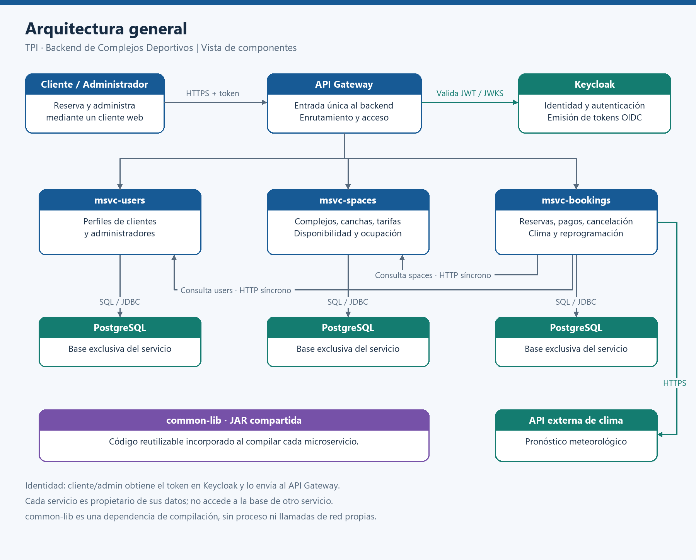
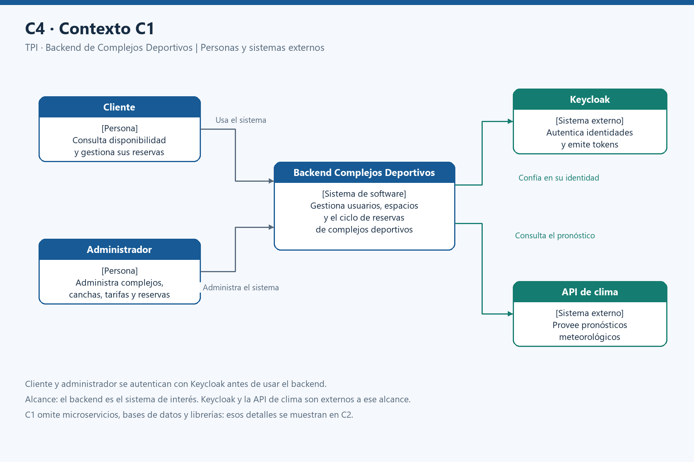
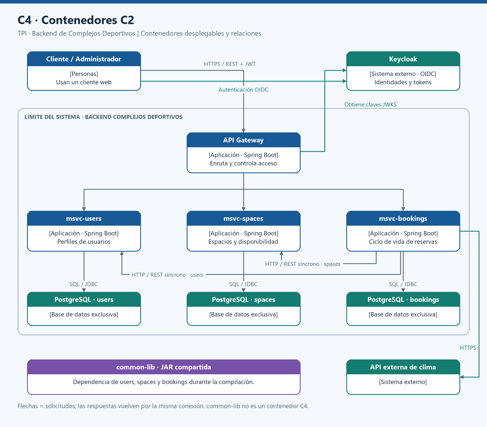

# TPI Backend — Gestión de Complejos Deportivos

Trabajo Práctico Integrador de la materia **Backend de Aplicaciones** de Ingeniería en Sistemas de Información — UTN Facultad Regional Córdoba.

## Descripción del proyecto

El proyecto consiste en desarrollar un sistema backend basado en una arquitectura de microservicios para gestionar complejos deportivos, sus canchas y las reservas realizadas por los clientes.

El sistema permitirá administrar la disponibilidad de las canchas, registrar reservas, gestionar pagos de señas, aplicar bonificaciones y realizar reprogramaciones ante condiciones climáticas desfavorables o tareas de mantenimiento.

## Arquitectura

El sistema estará compuesto por tres microservicios principales:

### 1. msvc-users
Responsable de gestionar los perfiles de clientes y administradores, así como su vinculación con Keycloak.

### 2. msvc-spaces
Responsable de gestionar los complejos deportivos, canchas, deportes, horarios, tarifas y ocupaciones.

También controlará la disponibilidad de los turnos, evitando reservas superpuestas.

### 3. msvc-bookings
Responsable de gestionar el ciclo de vida de las reservas:

- Solicitud y retención de turnos.
- Registro de pagos y confirmación.
- Cancelaciones.
- Evaluación de condiciones climáticas.
- Reprogramaciones.
- Bonificaciones por reservas frecuentes.

### Componentes adicionales

- **API Gateway:** punto de entrada al backend, enrutamiento y control de acceso.
- **Keycloak:** autenticación, autorización y administración de identidades.
- **Common Library:** librería JAR reutilizable entre microservicios.
- **API climática externa:** consulta de pronósticos para evaluar reservas.

### Diagrama general de arquitectura



## Tecnologías

- Java
- Spring Boot
- Spring Security
- Spring Cloud Gateway
- Spring Data JPA / Hibernate
- Spring RestClient
- Keycloak
- PostgreSQL
- Maven
- Docker y Docker Compose
- Swagger / OpenAPI
- Git y GitHub

## Estructura del repositorio

Se utilizará un único repositorio para todos los microservicios (monorepo).

```text
backend-complejos-deportivos/
├── msvc-gateway/
├── msvc-users/
├── msvc-spaces/
├── msvc-bookings/
├── common-lib/
├── docs/
│   └── img/
│       ├── arquitectura-general.png
│       ├── c4-contexto-c1.png
│       └── c4-contenedores-c2.png
├── .gitignore
└── README.md
```

*La estructura se incorporará progresivamente durante el desarrollo.*

Docker Compose incluye Keycloak con su propia base PostgreSQL y otro PostgreSQL para los microservicios, ambos con volumenes persistentes. Ver las [instrucciones de Keycloak local](infra/keycloak/README.md) y [PostgreSQL de los microservicios](infra/postgres/README.md).

### Configuración local

Se requiere JDK 25. Los puertos predeterminados son: gateway `8080`, users `8081`, spaces `8082` y bookings `8083`.

Docker Compose publica PostgreSQL de los microservicios en `localhost:5433` y crea `users_db`, `spaces_db` y `bookings_db` al inicializar su volumen por primera vez. No requiere instalar PostgreSQL ni pgAdmin. Cada servicio carga su propio archivo `.env` desde su carpeta de ejecución. Los archivos `.env` están excluidos de Git; las plantillas `.env.example` se comparten en el repositorio.

Para una nueva copia del repositorio, ejecutar desde la carpeta de cada servicio:

```powershell
Copy-Item .env.example .env
```

Preparar tambien el `.env` raiz siguiendo la [guia de PostgreSQL](infra/postgres/README.md). Los usuarios de los servicios son `users`, `spaces` y `bookings`. Copiar `USERS_DB_PASSWORD`, `SPACES_DB_PASSWORD` y `BOOKINGS_DB_PASSWORD` del `.env` raiz al `DB_PASSWORD` del servicio correspondiente. El gateway no necesita credenciales de base de datos. Levantar Docker Compose desde la raiz y luego iniciar desde la carpeta del servicio:

```powershell
.\mvnw.cmd spring-boot:run
```

La carga se configura mediante `spring.config.import=optional:file:./.env[.properties]`. El archivo se interpreta como Java properties: usar `CLAVE=valor`, sin `export` ni comillas alrededor de los valores. Para valores que contengan barras invertidas, escaparlas como `\\`. Cada servicio puede usar credenciales diferentes. Las variables de entorno de la terminal tienen prioridad sobre el `.env`. En el IDE, establecer la carpeta de cada servicio como directorio de trabajo.

La variable opcional `DB_URL` permite reemplazar la URL JDBC completa de cada servicio; `SERVER_PORT` permite cambiar su puerto. Para desarrollo local, Hibernate usa `ddl-auto=update`: crea y actualiza tablas a partir de las clases `@Entity` al iniciar cada microservicio. Los cambios complejos de esquema pueden requerir SQL o migraciones; revisar esta opcion antes de desplegar fuera del entorno local.

El gateway reenvía `/api/users/**`, `/api/spaces/**` y `/api/bookings/**` conservando la ruta completa. Sus destinos se pueden cambiar con `USERS_SERVICE_URL`, `SPACES_SERVICE_URL` y `BOOKINGS_SERVICE_URL`. Si cambia el puerto de un servicio, también debe cambiarse su destino en el gateway.

Keycloak dispone de un entorno Docker local; su integración con el gateway está pendiente. Spring Security permanece activo en el gateway con su configuración predeterminada; las rutas no quedan abiertas al acceso anónimo. Los controladores de los servicios todavía están pendientes.

## Metodología de trabajo

El equipo utilizará una metodología basada en **Kanban**, organizando las historias de usuario, tareas, responsables y estados de desarrollo mediante Notion.

### Estrategia de ramas

Se utilizará una estrategia de trabajo basada en **ramas individuales permanentes**, donde cada integrante tendrá su propia rama de desarrollo.

- `main`: rama principal que contendrá las funcionalidades terminadas, revisadas e integradas.
- `dev/nombre-integrante`: rama personal donde cada integrante desarrollará las funcionalidades que tenga asignadas.

Las ramas personales se mantendrán durante todo el proyecto, evitando la necesidad de crear y eliminar ramas por cada funcionalidad.

### Reglas de trabajo en las ramas

Cada integrante trabajará sobre **una única funcionalidad a la vez** en su rama personal.

1. Antes de comenzar una funcionalidad, deberá sincronizar su rama con la última versión de `main`.
2. Desarrollará la funcionalidad asignada, realizando los commits necesarios.
3. Una vez finalizada y probada, creará un Pull Request para integrar los cambios en `main`.
4. La funcionalidad deberá ser revisada y aprobada por otro integrante antes de realizar el merge.
5. **No comenzará otra funcionalidad hasta que la anterior haya sido integrada en `main`.**
6. Después de cada integración, actualizará su rama personal con los últimos cambios de `main` antes de comenzar una nueva tarea.

Las ramas personales serán permanentes durante todo el proyecto y no se eliminarán después de cada integración.

### Organización de las funcionalidades

Las historias de usuario estarán registradas en el tablero Kanban de Notion.

Cada funcionalidad tendrá un responsable asignado, quien se encargará de su implementación, pruebas y documentación.

Los estados utilizados serán:

- **Pendiente:** funcionalidad todavía no iniciada.
- **Lista para empezar:** funcionalidad disponible para comenzar.
- **En curso:** funcionalidad en desarrollo.
- **En revisión:** funcionalidad terminada, pendiente de revisión e integración.
- **Terminada:** funcionalidad integrada y verificada.

## Documentación

La documentación del proyecto incluirá:

- Modelo de dominio y reglas de negocio.
- Diagramas de bases de datos.
- Diagramas de arquitectura C4 (C1 y C2).
- Documentación de APIs mediante Swagger/OpenAPI.
- Instrucciones de instalación y ejecución.

### Diagramas C4

#### C1 — Diagrama de Contexto



#### C2 — Diagrama de Contenedores


## Estado del proyecto

**En etapa inicial de configuración.**

Actualmente se está definiendo la estructura del repositorio, la organización del equipo y las configuraciones necesarias para comenzar con el desarrollo de los microservicios.

## Organización

**Universidad:** Universidad Tecnológica Nacional — Facultad Regional Córdoba

**Carrera:** Ingeniería en Sistemas de Información

**Materia:** Backend de Aplicaciones

**Proyecto:** Trabajo Práctico Integrador
